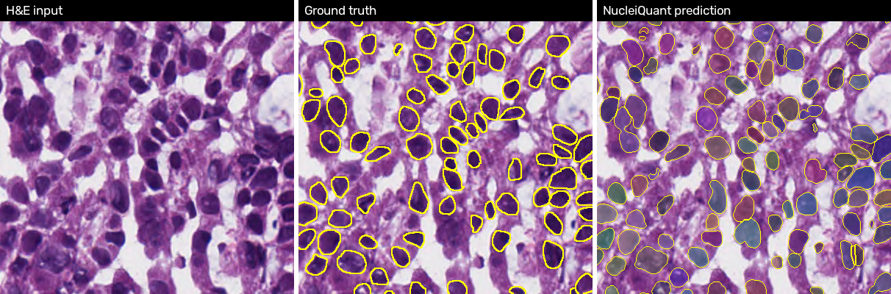
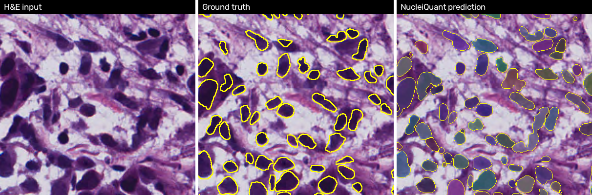

# NucleiQuant — Nuclei Segmentation & Quantification for H&E Histology

Automatically **detect, segment, count and measure cell nuclei** in microscopic tissue images.
Upload an H&E image → get an annotated overlay, per-nucleus morphometrics (area, perimeter,
circularity, eccentricity…), image-level statistics (count, density, nuclear area fraction) and a CSV.



> Research / workflow-assist tool. Not a medical device; it does not diagnose.

## Results (MoNuSeg 2018 official test set, 14 images, 6,697 nuclei)

| Metric | Value | |
|---|---|---|
| **Dice** (pixel) | **0.825** | |
| IoU (pixel) | 0.703 | |
| **AJI** (Aggregated Jaccard Index) | **0.648** | the MoNuSeg challenge metric |
| Instance F1 @ IoU 0.5 | 0.819 | precision 0.774 / recall 0.870 |
| Count MAE | 60.7 nuclei / image | consistent over-count (+13 %) |
| Inference | **1.0 s** per 1000×1000 image | Apple M-series (MPS), flip-TTA on |
| Parameters | 7.2 M | |

Single U-Net, no pretraining, 39 epochs (~16 min on a MacBook). Full per-image numbers in
[`results/per_image.csv`](results/per_image.csv), training curve in
[`results/history.jsonl`](results/history.jsonl).

### Context — published numbers on the same test set

| Model | Dice | AJI |
|---|---|---|
| U-Net, binary (Kumar et al. 2017 baseline) | ~0.79 | ~0.50 |
| Mask R-CNN | ~0.76 | ~0.55 |
| HoVer-Net (Graham et al. 2019) | ~0.83 | ~0.62 |
| **NucleiQuant (U-Net + boundary head + watershed)** | **0.825** | **0.648** |

### Per-organ breakdown

MoNuSeg's training set contains breast, kidney, liver, prostate, bladder, colon and stomach.
**Lung and brain are unseen organs** — and are among the best-scoring, which suggests the model
is learning nuclear morphology rather than organ-specific texture.

| Organ | Images | Dice | AJI | F1 | Count error |
|---|---|---|---|---|---|
| Brain *(unseen)* | 2 | 0.843 | 0.680 | 0.844 | +36 |
| Lung *(unseen)* | 2 | 0.833 | 0.668 | 0.826 | +90 |
| Bladder | 2 | 0.834 | 0.663 | 0.847 | +88 |
| Prostate | 2 | 0.834 | 0.663 | 0.825 | +48 |
| Kidney | 3 | 0.824 | 0.658 | 0.831 | +54 |
| Colon | 1 | 0.805 | 0.596 | 0.777 | +32 |
| Breast | 2 | 0.793 | 0.580 | 0.756 | +67 |

### Where it fails



Breast tissue is the hardest case: densely packed, overlapping nuclei with weak boundaries.
Recall (0.87) is consistently higher than precision (0.77): the model finds nearly every
annotated nucleus but also segments faint, out-of-focus nuclei that the annotators skipped,
and occasionally splits one large nucleus in two. Both show up as the positive count bias.
These are post-processing knobs (`min_nucleus_area`, `boundary_threshold`) rather than model
limitations — see the roadmap.

## How it works

```
H&E image ─► pad + normalise ─► U-Net (2 heads) ─► marker-controlled ─► instance ─► regionprops ─► CSV / overlay
                                 fg + boundary       watershed           labels      morphometrics    / summary
```

* **Model** — U-Net (PyTorch, 32 base channels, depth 4) predicting two maps: *nucleus foreground*
  and *nucleus boundary*. Predicting the boundary explicitly is what lets a plain U-Net split
  touching nuclei; a binary U-Net merges them.
* **Post-processing** — `foreground − boundary` gives one seed per nucleus; distance-transform
  peaks add seeds for any blob still unseeded; watershed grows seeds back to full nuclei; tiny
  artefacts are dropped.
* **Quantification** — classical, deterministic `skimage.regionprops` measurements, optionally
  calibrated to µm with a microns-per-pixel value.
* **Evaluation** — Dice, IoU, AJI, instance precision / recall / F1 @ IoU 0.5, count MAE,
  inference time, parameter count, GPU memory.
* **Training** — BCE + soft-Dice loss (boundary channel up-weighted 2×), AdamW + OneCycle,
  256×256 random crops with flips / 90° rotations / HSV stain jitter, validation on full
  1000×1000 images after the real post-processing, early stopping on AJI.

## Repository layout

```
NucleiQuant/
├── app/app.py                      Streamlit app (upload → segment → quantify → export)
├── configs/unet_monuseg.yaml       All hyper-parameters; override any key from the CLI
├── nucleiquant/
│   ├── data/monuseg.py             Aperio XML → instance mask
│   ├── data/prepare_monuseg.py     Raw MoNuSeg → processed PNGs + meta.csv
│   ├── data/dataset.py             Random-crop dataset, augmentations, target generation
│   ├── models/unet.py              U-Net
│   ├── losses.py                   BCE + soft Dice with per-channel weights
│   ├── inference.py                Full-image / tiled prediction, flip TTA, checkpoint loading
│   ├── postprocess.py              Watershed instance separation
│   ├── quantify.py                 Per-nucleus measurements + image summary
│   ├── metrics.py                  Dice, IoU, AJI, PRF@0.5, count MAE
│   └── utils.py                    Config, device (CUDA/MPS/CPU), seeding, overlays
├── scripts/
│   ├── train.py                    Training loop, validation on full images, early stopping
│   ├── evaluate.py                 Metrics report (per-image CSV + summary JSON + overlays)
│   ├── predict.py                  Batch inference CLI
│   └── make_synthetic_data.py      Fake dataset to verify the environment end-to-end
├── tests/test_pipeline.py          9 smoke tests, no dataset needed
├── results/                        Metrics and training history of the reported run
└── docs/                           Figures
```

## Setup

```bash
git clone https://github.com/Dpk021/NucleiQuant.git && cd NucleiQuant
python3 -m venv .venv && source .venv/bin/activate      # or: uv venv
pip install -r requirements.txt                          # or: uv pip install -r requirements.txt
python -m pytest -q tests/                               # → 9 passed
```

Device is auto-selected (`cuda` → `mps` → `cpu`). Force one with `--set device=cpu` on the
scripts or the sidebar in the app.

### Dataset

1. Download the **MoNuSeg 2018 Training Data** and **MoNuSeg Test Data** from
   <https://monuseg.grand-challenge.org/Data/> (free registration).
2. Unzip under `data/raw/monuseg/`.
3. Convert XML annotations to instance masks:

```bash
python -m nucleiquant.data.prepare_monuseg \
    --train "data/raw/monuseg/MoNuSeg 2018 Training Data" \
    --test  "data/raw/monuseg/MoNuSegTestData" \
    --out   data/processed/monuseg
# → 37 train + 14 test images, 30,828 nuclei
```

### Train / evaluate / run

```bash
python scripts/train.py --config configs/unet_monuseg.yaml
#   ~25 s/epoch on an Apple M-series GPU; on CUDA raise model.base_channels=64, train.batch_size=16

python scripts/evaluate.py --checkpoint outputs/checkpoints/unet_monuseg_baseline/best.pth \
    --split test --out outputs/eval/baseline --save-overlays --tta

python scripts/predict.py --checkpoint outputs/checkpoints/unet_monuseg_baseline/best.pth \
    --input path/to/images --out outputs/predictions

streamlit run app/app.py
```

The app shows the overlay, probability maps, area / shape distributions, a per-nucleus table and
download buttons; upload the matching MoNuSeg XML to get live Dice / AJI / F1 for that image.
Post-processing thresholds are sliders, so you can watch count error respond in real time.

No dataset yet? `python scripts/make_synthetic_data.py` creates fake blobs in the processed layout
so the whole pipeline can be exercised in two minutes.

## Roadmap

- [x] U-Net + boundary head + watershed, metrics, Streamlit app, MoNuSeg results
- [ ] Tune `min_nucleus_area` / `boundary_threshold` on a validation split to remove the +13 % count bias
- [ ] Ablation: 1-channel binary U-Net (`--set model.out_channels=1`) vs 2-channel boundary U-Net
- [ ] Stain normalisation (Macenko) as a preprocessing option
- [ ] HoVer-Net style horizontal / vertical distance maps for better separation of overlapping nuclei
- [ ] Nuclei *classification* on CoNSeP (epithelial / inflammatory / stromal)
- [ ] Whole-slide tiling with `openslide` and a nuclear-density heat-map

## Limitations

H&E only; trained on one dataset (MoNuSeg, 40×, TCGA scanners) so stain and magnification shifts
will degrade results without normalisation; no nucleus-type classification; count bias is positive
on every organ. It assists quantification — it does not make or support a diagnosis.

## References

- Kumar N. et al., *A Dataset and a Technique for Generalized Nuclear Segmentation for Computational Pathology*, IEEE TMI 2017 (MoNuSeg, AJI)
- Ronneberger O. et al., *U-Net: Convolutional Networks for Biomedical Image Segmentation*, MICCAI 2015
- Graham S. et al., *HoVer-Net: Simultaneous Segmentation and Classification of Nuclei in Multi-Tissue Histology Images*, Medical Image Analysis 2019
